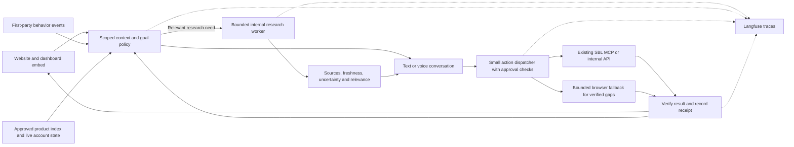

# SBL CX: discovery-backed capability summary and implementation plan

**29 September 2026 · Planning only · No application implementation or production changes**

This plan refines the [CX product document](04-ai-cx-concierge-launch-plan.md) using actual website and authenticated app discovery. For the next implementation, use this plan’s confirmed decisions and sequence; retain the larger CX document for experience detail, Mermaid diagrams and scenario coverage.

## What you need to know, simply

- One branded assistant lives on sbl.so and in the dashboard. Visitors install nothing.
- It understands the current page, relevant behavior, stated goal, workspace, permissions and actual product state.
- It changes its goal with the customer: discovery, conversion, activation, continued value, support, retention or expansion.
- It asks only for missing information that changes what it should do next.
- It performs supported work, shows progress and verifies the result. It should not simply explain which buttons to click.
- It can perform consequential work after a specific confirmation: “Delete this campaign?” → “Yes” → check authority, execute, verify and report.
- It reuses SBL’s existing MCP/API actions before relying on browser clicks.
- It remembers confirmed context across signup and return visits, within the correct account/workspace.
- It uses live dashboard pricing and eligibility as the authority; an offer must actually exist before it mentions it.
- It records useful behavioral events and agent traces so the team can see what worked, what failed and why the goal changed.
- It starts with a polished experience and a few complete workflows. More data, models and actions are added when they improve results.
- It spawns internal research agents for relevant competitor/market questions, then turns sourced findings into optional actions. No external-agent interoperability is required.

## What discovery established

**Public site:** 213 URLs mapped; 20 pages/documents read across the homepage, pricing, LinkedIn, WhatsApp, agencies, SDR profiles, email, HeyReach, GTM signals, case studies, help, API and MCP. A discovery agent exercised homepage Agency selection → pricing → trial signup entry without submitting.

**Authenticated app:** All main sidebar families were opened in the in-app browser. Inspected campaign lists in two workspaces; seven workspace entries inventoried; selected campaign detail/configuration, new-campaign dialog, reports, contacts/import entry, ICP leads, signals/hiring form, enrichment, CRM board, knowledge source types, MCP/API, channels, workspace/member/persona settings, profile purchase screen and billing. No campaign, message, job or purchase was submitted. No sensitive account data is reproduced in this plan.

This is a broad discovery map, not a claim that every page, record, role or backend operation has been tested. Full inventory and limits: [public evidence](07-sbl-public-site-discovery-2026-09-29.md), [app evidence](08-sbl-app-discovery-2026-09-29.md).

**The biggest simplification:** The [public MCP guide](https://sbl.so/mcp/) documents 30 tools, and the app has an actual MCP setup/key-management screen. The [API guide](https://sbl.so/api/) documents campaign operations and outcome webhooks. The next build should connect context and experience to these existing capabilities—not start by building a universal browser robot. Documented tools still need runtime contract and permission verification.

## Where the concierge should appear, and what it should do

These are proposed CX behaviors grounded in observed screens. “Do” requires a validated executor; a visible button alone is not proof of a safe automation contract.

| Current surface / context | Natural invitation or response | Work the agent should complete |
|---|---|---|
| Homepage, no stated goal | “Hey—what are you hoping to do with SBL?” when eligible | Explain fit, select relevant example, navigate to the requested product or next step |
| Agency tab or agency page | “Are you setting this up for one client or several?” | Use explicit client/volume inputs to prepare a workspace and outreach setup plan; later create the selected workspace after supported authority checks |
| LinkedIn or WhatsApp landing page | “What outcome do you want from this channel?” | Preserve channel, audience and goal into an appropriate app workflow |
| Pricing comparison | “Want help choosing for your team?” | Compare approved plan facts and relevant dashboard offer; carry chosen intent into signup; use the real demo destination |
| SDR profile page/calculator | “Want me to work out what this quantity would cost?” | Retrieve actual quantity/add-on quote; prepare the selection; complete supported purchase only after exact quote approval and required user-controlled payment steps |
| Email / HeyReach / GTM / affiliate page | Respond to that offer’s actual purpose | Route to the correct setup/invite/partner journey. Do not substitute a LinkedIn campaign or promise unverified availability |
| New dashboard, no campaigns | “What are you selling, to whom, and what should happen next?” | Create a saved campaign from agreed brief/channel; verify the returned object; surface sender/lead requirements |
| Existing draft | “Want me to finish the missing setup?” | Inspect the existing object, complete the requested supported components and verify changes |
| Active/paused/ended campaign | “I can check what is happening and help with the next step.” | Read current state, diagnose blockers, propose and execute authorized edits or lifecycle actions with specific approval where needed |
| Leads / Signals / Contacts | “Do you have a list, a target audience, or a relevant post?” | Choose the right discovery/import route, gather missing inputs, preview the result/cost and run approved jobs; report progress and counts |
| Enrich | “What information do you need about these leads?” | Prepare research fields, verify access and execute a supported enrichment job after any required cost approval; currently executor coverage unverified |
| Chats / human intervention | “Want me to identify what needs your attention?” | Triage relevant conversations, prepare a reply, send and resolve after the user approves the exact recipient/content |
| Reports | “What would you like to understand or improve?” | Retrieve scoped results, distinguish metrics from estimates, explain gaps and carry a chosen improvement into a supported action |
| Channels / disconnected sender | “This sender needs reconnecting before it can send.” | Open the exact reconnect flow, let the user complete authentication, then recheck readiness and resume the original task |
| Knowledge Base / Persona / CRM | “I can help organize this for your goal.” | Reuse the existing source/persona/board workflow; mutation support is added only after verifying the relevant contract |
| Returning or inactive user | “Continue your earlier task, or has your goal changed?” | Refresh old state, resume useful work or replace the goal. Do not infer churn from absence |
| Support or cancellation concern | Address the stated concern first | Resolve a supported issue, perform an approved supported change, or prepare a useful human handoff without obstructing the request |
| Relevant competitor or market question | “Let me research that and bring back useful options.” | Spawn a bounded internal researcher, show sourced findings and relevance, then create a requested supported draft; confirm consequential follow-through |

“Hey” is a light greeting, not an automatic full-screen takeover or microphone activation. Proactive timing must respect dismissal, active typing, hidden tabs and task focus.

## Agent capabilities: execution, not advice alone

### First action families to validate and ship

- **Find and inspect work:** campaigns, individual configuration, analytics, lead membership, relevant conversations and LinkedIn sender state.
- **Prepare and update campaigns:** create from a prompt, update specific components, create a retargeting draft and bind a selected sender where permitted.
- **Bring in leads:** CSV import, Sales Navigator import, post engagement preview/import, prompt-based lead discovery and approved sample extraction.
- **Handle campaign work:** run/end and other lifecycle changes supported by verified contracts; send a reviewed message; reply and resolve intervention.
- **Verify each outcome:** check saved object, import/job status, selected sender revision or message/task status. “Submitted” and “delivered” are separate states.

The existing 30-tool map is in the public evidence report. Prompt-lead approval is documented as billable; imports and adding a user to a running campaign may also have downstream effects. Classification is based on actual consequences, not a friendly tool name.

### Capabilities to investigate next, not claim implemented

Workspace creation/deletion, arbitrary campaign deletion, member changes, CRM moves, knowledge-source mutations, enrichment, profile purchases, account billing changes and additional offers need verified API or UI contracts. The visible UI supports parts of these workflows, but the inspected tool catalogue does not establish all of them. Their future agent behavior is **confirm and execute when supported**, not permanently refuse.

### Confirmation contract agreed by the founder

1. State the exact action, target/workspace, meaningful effect and cost where relevant.
2. Ask a specific question, e.g. “Delete campaign X in workspace Y?”
3. Bind the user’s “yes” to that single proposal. It is not general permission for future deletes or a different object.
4. Recheck current authority and object state. A changed target, scope or quote requires an updated confirmation.
5. Execute through the verified interface; reconcile uncertain results before retrying.
6. Report the actual outcome and provide undo only where the product really supports it.

Reversible work can proceed within the user’s stated task scope under the proposed policy. Consequential actions are not categorically blocked; they have a short approval path. Platform-required authentication, payment or security interactions remain user-controlled where necessary. This policy defines the future product and does not authorize this discovery session to change live campaigns.

## Behavioral context and where it will live

Start with a small event collector in both site embeds. Use the current application data store/event infrastructure if it can meet these requirements; its identity remains an implementation-discovery question. Do not choose another analytics vendor before checking what SBL already runs.

| Record | Minimum useful content | Destination / purpose |
|---|---|---|
| Behavioral event | Event ID/time, site/page/content version, session, allowed identity/workspace, semantic target, actor, consent/capture status | First-party event storage; understand journeys and conversion |
| Exposure summary | Key section/CTA, visible-time estimate, enabled state, clicks/no-click window, missing capture | Same event store; distinguish exposed-but-unused from never seen |
| Task/context summary | Confirmed goal, current stage, important unknowns, relevant object IDs, freshness and prior result | Account/workspace-scoped application storage; resume work |
| Agent trace | Context reference, goal change, rules/Jev/model version, source IDs, tool attempt, latency, cost and outcome | Langfuse; diagnose behavior and evaluate changes |
| Research result | Parent task, bounded question, source URLs/retrieval dates, findings, uncertainty, relevance, budget and status | Existing application storage for reusable findings; child spans in Langfuse; no separate research platform |
| Action receipt | Proposal/approval reference, actor/workspace, target revision, idempotency key where supported, result and verification | Existing audit storage or a small app table; authoritative action record |
| Product/capability index | Source URL, page/offer/module, availability, approved facts, executor, scope and validation date | Versioned reviewed catalogue; initial file/table is sufficient |

**Capture first:** route/section, explicit persona tabs, calculator inputs, plan selection, meaningful clicks, visible/active time, validation failures, goal statements, campaign/task changes and outcomes. Distinguish visitor actions from agent-generated actions.

**Evaluate before expanding:** pointer/hover summaries and negative-click signals for key CTAs. Mouse position and viewport exposure are attention proxies, not eye tracking. Avoid raw keystrokes, full contact lists, credentials and unbounded screen capture. Mobile/keyboard visitors must work without cursor data.

**Refresh:** collect relevant runtime events continuously while active; update the catalogue after approved product/offer changes; use campaign webhooks for outcome changes. SBL’s seven documented campaign webhook events do not replace website behavior collection. Pause or degrade respectfully when tracking is unavailable.

**Retention proposal:** 30 days for raw behavioral/session context and trace payloads; longer-lived aggregate metrics as needed; action audit retention follows the existing product policy. Confirm against SBL’s current operational/privacy requirements before implementation. Respect deletion across linked records. No collector, recurring job or trace export was installed during this task.

### Pricing authority, reflecting the founder’s instruction

- Current dashboard/backend price, selected quantity/add-ons, account eligibility and actual offer terms determine the actionable quote.
- Public pricing may be shown as published context; label its scope and date and do not assume it applies to every account.
- If the dashboard supplies a valid promotion, show both the relevant public reference and the actual offer with conditions. Never invent urgency or a discount.
- The inspected billing view showed Free Active for this account; that is not enough to quote every package. A proper scoped pricing/offer lookup is still required.
- When pages differ and no authoritative quote is accessible, explain the uncertainty and offer a human clarification rather than guessing.

## Minimum implementation shape

These boxes are responsibilities, not a request for separate microservices. Prefer one existing backend deployment plus the embed. Keep secrets server-side and use a scoped authenticated bridge for the user/workspace. Do not expose account-wide MCP keys in a visitor script. The marketing/app domains need an explicit short-lived handoff; browser storage cannot be assumed shared across them.

Jev remains a candidate for intent/routing decisions, not the execution engine or memory store. Simple rules handle clear eligibility, explicit user instructions and permissions; a conversational model handles language. Introduce Jev only where a held-out comparison demonstrates benefit.

## Updated milestones and delivered capabilities

These milestones are cumulative planned capabilities, not implemented features. An earlier internal preview may ship behind flags; the complete planned pilot includes M1–M7. Re-estimate dates after M1 verifies the real repositories and contracts. This sequence supersedes earlier provisional calendars and external-agent scope.

| Milestone | Capability available at completion | Completion evidence | Work packages |
|---|---|---|---|
| M1 — Advanced core on both surfaces | Improve the existing extension across a `sbl.so` landing/pricing page and the SBL dashboard: grounded answer, context/goal choice, continuity, existing-tool campaign read, agreed draft and verified readback in a safe workspace. Map the MCP catalogue and trace the result. | Extension website-to-dashboard answer-to-draft journey, persisted draft proof in an approved safe workspace, inspectable trace and supported/unverified/unsupported capability map | T01; T02 foundation; T04/T05/T09 first slice; T06 first draft slice |
| M2 — Branded interaction and product knowledge | Improve the extension's brain/avatar, complete text experience, optional voice, clear progress/results and reviewed product knowledge on both website and dashboard. | Website and dashboard extension journeys, grounded answers, keyboard/mic-denial proof and no invented pricing or availability | T02–T03; T09 |
| M3 — Context and changing goals | Across both extension surfaces, understand page/section, meaningful clicks, exposure without clicks, active time, explicit intent and verified workspace state; shift between lifecycle goals and resume permitted context. | Lifecycle fixtures, suppression, website-to-dashboard continuity and workspace isolation; inspectable traces and extension-free handoff contract ready for M7 | T04–T05; T09 |
| M4 — Conversion and first useful work | Guide plan/demo/signup decisions using authoritative offers; carry the brief through the extension's website-to-dashboard journey, reuse or complete a saved draft and complete the selected validated lead workflow. | Extension continuity and persisted draft proof; approved import/job outcome verified; no false-success reports | T06–T07; T02/T05 integration |
| M5 — Support, retention and confirmed execution | Diagnose supported campaign/sender issues, explain results, resume unfinished work and handle reviewed run/end/message actions. Ask for exact confirmation, then execute and verify; deletion joins only once its contract passes. | Confirmation/recheck/execute/verify cases, no duplicate effects, returning/inactive/support journeys and useful human handoff | T08; selected T11; T09 |
| M6 — Internal research and useful recommendations | Spawn a bounded researcher for relevant competitor/market questions; return sourced findings, explain their relevance and turn an accepted suggestion into a verified draft. Consequential follow-through uses M5 approval. | Useful and inconclusive research, freshness/conflict review, cancellation/budget limits, parent/child traces and research-to-draft proof | T10; depends on T02/T04–T06/T09 |
| M7 — Native embed and measured pilot | Move proven extension capability into a small WordPress script/iframe and minimal dashboard frontend mount; verify extension-free continuity, feedback, cost/latency monitoring, flags and rollback. Measure useful work/continued use, signup/demo conversion and support resolution. | Clean-browser website/dashboard journeys, end-to-end gates, independent review, no critical defects, monitored cohort and rollback rehearsal | T03 deployment; T04/T06 handoff; T12; T09 completion |

Tracing starts with the first working slice, not M7. Basic lifecycle awareness and support answers arrive before deeper execution. Jev remains an evaluated option; broad research monitoring and unverified product mutations are not launch dependencies. Each milestone ends in a demonstrable user journey plus evidence, not merely infrastructure completion.

## Genesis-ready work packages

**Current state:** Specification awaiting approval. **Evidence:** Existing extension source, the two live-discovery reports, and source inspection of `sbl-app` and `sbl-mcp`. The founder owns WordPress deployment and clarified that HumanLayer means Genesis. **Open dependencies:** Safe draft workspace, app deployment reviewer, identity/offer contract and telemetry suitability. **Next action:** Approve the checked SPEC.md, then prepare and approve the executable plan. No implementation approval has been recorded by this document.

The requirements and gates below are proposed acceptance contracts. They have not been implemented or passed. Use the existing repo’s native test tools; avoid introducing a new test platform.

| Task | Requirement | Bounded work and dependencies | Executable proof to implement |
|---|---|---|---|
| T01 First integration and capability map | FR-CX-001 | Use the located `sbl-app`/`sbl-mcp` code through the extension on website and dashboard, verify the minimal identity/read/draft path, and classify the existing MCP catalogue. Check additional tool contracts when those capabilities are added | Website-to-dashboard continuity, authorized/wrong-workspace read and representative safe-workspace draft/readback; map marks supported, unverified and unsupported actions |
| T02 Initial knowledge and offer boundary | FR-CX-002 | Curate homepage, pricing, one landing page and the first app workflow; exclude legacy/test pages from answer authority. Bind dashboard offer truth before an actionable quote. Depends on T01 | Grounded QA fixtures covering pricing conflicts, coming-soon features, separate offers and missing eligibility |
| T03 Branded experience then native embed | FR-CX-003; NFR-CX-001 | M2: improve avatar/UI, complete text path and optional voice in the website/dashboard extension. M7: adapt proven code to WordPress and a small app frontend mount | M2 extension interaction checks on both surfaces; M7 clean-profile website/app tests with no extension or localhost, mic denial, keyboard/mobile and host usable on failure |
| T04 Scoped session and behavior pipeline | FR-CX-004; NFR-CX-002 | Event collection, exposure summaries, identity handoff, confirmed facts and task resume. Reuse event store | Hidden-tab vs visible-time, agent-vs-user clicks, event retry/deduplication, signup resume, account/workspace switch and deletion fixtures |
| T05 Contextual goal policy | FR-CX-005 | Stage-specific response selection and suppression; use source-backed account state. Depends on T02/T04 | Known/unknown cases for new visitor, pricing, empty account, existing campaign, returning/inactive user, support override and dismissal |
| T06 Complete first campaign workflow | FR-CX-006 | M1: agreed draft through existing create/read tools in a safe workspace. M4: extension-based website-to-dashboard brief handoff, existing-draft reuse, remaining prerequisites and selected lead workflow. M7: extension-free handoff | M1 proof shows a persisted run-owned draft; M4 journey covers existing draft, validation, timeout, duplicate and conflict recovery; M7 proves native handoff |
| T07 Lead workflows | FR-CX-007 | Reuse CSV, Sales Navigator, engagement and prompt tools incrementally. Depends on T01/T06 | Preview → confirmed cost/side effects → job → verified membership; duplicate jobs, limits, expired authority and failure tested |
| T08 Campaign operations and support | FR-CX-008 | Confirm-and-execute run/end/message/intervention; scoped results and sender diagnosis. Depends on T01/T06 | Proposal/yes/recheck/execute/verify tests; changed target invalidates yes; no double send; queued/delivered distinguished |
| T09 Tracing and operator control | FR-CX-009; NFR-CX-003 | Instrument from the first vertical slice; Langfuse correlation, receipts, budget, capability disable and feedback | Real test traces contain context-to-result chain; secret masking; exporter outage; kill-switch stops new actions |
| T10 Internal research and recommendations | FR-CX-010 (revised scope) | One bounded research worker; public-source brief, freshness, cache/deduplication, cancellation and relevant recommendation. Depends on T02/T04–T06/T09; resulting consequential actions use T08 | Source/relevance review; stale/conflicting/no-evidence cases; privacy, budget-stop and cancellation proof; parent/child spans; accepted suggestion becomes a verified draft |
| T11 Additional product actions | FR-CX-011 | Workspace/CRM/knowledge/enrichment/billing/delete capabilities selected by demand; each requires verified contract | Per-capability authority, confirmation, completion and recovery fixtures; unsupported actions are never advertised as executable |
| T12 Pilot and controlled rollout | AC-CX-001 | End-to-end proof on website and dashboard; all three outcome tracks; no critical open defects | Version-bound journeys, rollback/disable rehearsal, latency/cost report and required independent review |

T09 begins alongside T03/T06; it is not a late observability project. T11 is an expansion queue, not a requirement to ship every product mutation on day one. A first pilot includes discovery/conversion, a completed activation action, returning-user continuity and support/resolution; broader execution grows behind capability flags. Jev does not block the pilot. Bounded internal research is M6; an earlier core preview must state that research is not yet available. Always-on monitoring remains an experiment.

### How autonomous implementation will work later

1. Inspect/adopt the real repository through Genesis discovery; do not initialize a competing harness inside this planning folder.
2. Write the specification with the stable requirements above, evidence, assumptions and invariants. Run its specification check and obtain the actual human approval.
3. Create bounded tasks with file ownership, dependencies, runtime scenarios and executable gates. Show the plan for human approval before activation.
4. For each authorized task, implement, run its proof against current source, inspect actual outputs and resolve failures. Record deviations and newly discovered unknowns.
5. Use independent review for medium/high-risk work and the actual required approval gates. Agent self-reported completion is insufficient.
6. Roll out to a controlled cohort after evidence passes; use a kill switch and rollback. Continue through already-authorized work without asking for repeated permission, but do not invent approvals or replay uncertain external effects.

These future steps follow [Genesis](/path/to/developer/.codex/skills/genesis/SKILL.md). Today’s stop is the requested planning boundary, not an implementation blocker or a request for premature deployment approval.

## Product proof and rollout

Track three outcome groups, as requested:

- **Useful work and continued use:** verified task completion, time to useful result, resume success and return usage.
- **Website signup/demo conversion:** completed signup or booking, contextual question resolution and explicit handoff coverage; clicks are not completed conversions.
- **Support/resolution:** resolved issue or accepted handoff, repeat explanation, user correction and intervention handling time.

Use the earlier CX scenario library, plus the actual SBL screen cases in the evidence reports. An answer may correctly be a clarification or an unsupported boundary; do not implement a new agent for every test case. Start with internal non-production proof, then a small consenting cohort; treat early reactions as qualitative evidence. Re-estimate delivery after T01 instead of relying on the earlier provisional calendar.

## Decisions and remaining inputs

**Confirmed by founder:** “external agent” means an internally spawned research agent, not MCP or A2A interoperability; website script acceptable; Jev is the intended model candidate; full lifecycle; action-first behavior with explicit confirmation for consequential actions; all three outcome groups; dashboard pricing/eligibility is authoritative.

**Before Genesis activation:** obtain explicit specification and plan approvals. HumanLayer means Genesis. The founder owns WordPress deployment; safe test workspace and app deployment reviewer remain open. Do not claim M1's draft proof until a run-owned safe target exists.

**30 September founder direction:** Build the advanced concierge on both `sbl.so` landing/pricing pages and the actual dashboard through the existing Chrome extension now. Begin a website-to-dashboard capability in M1 and grow it across M2–M6; WordPress placement and native frontend integration happen near the end in M7. Prefer a simple WordPress script/iframe and minimal dashboard JavaScript mount over deep `sbl-app` changes. `sbl-app` and `sbl-mcp` locations are identified; existing OpenReplay, event tracking and Langfuse presence is source-confirmed, but contract suitability remains to be checked. No credentials are needed in chat.

**Proposed defaults until technical discovery:** reuse the current SBL backend and datastore; small reviewed catalogue; conservative event collection; runtime pricing lookup; one hosted conversation path; tool-first actions; no universal computer-use layer; existing product channels for human handoff. Mobile, permissions and result verification remain required.
