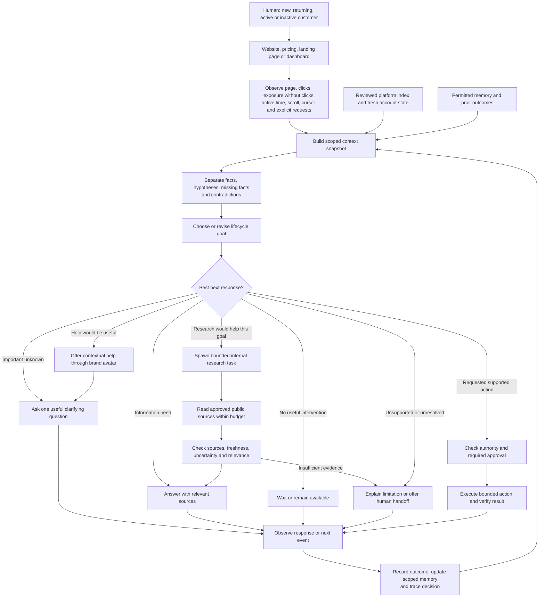
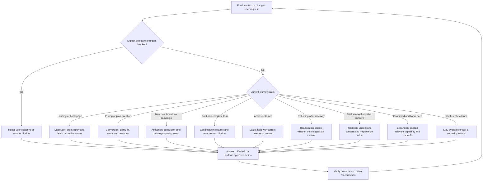
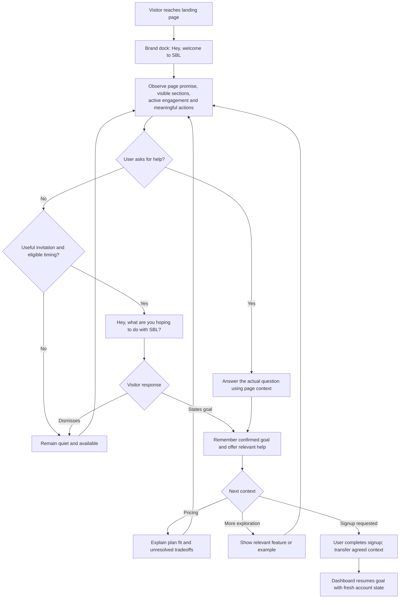
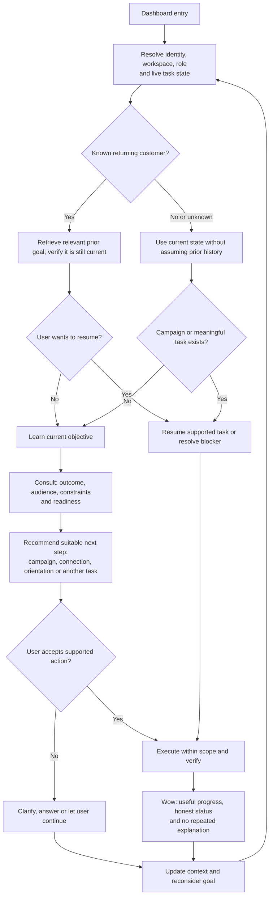
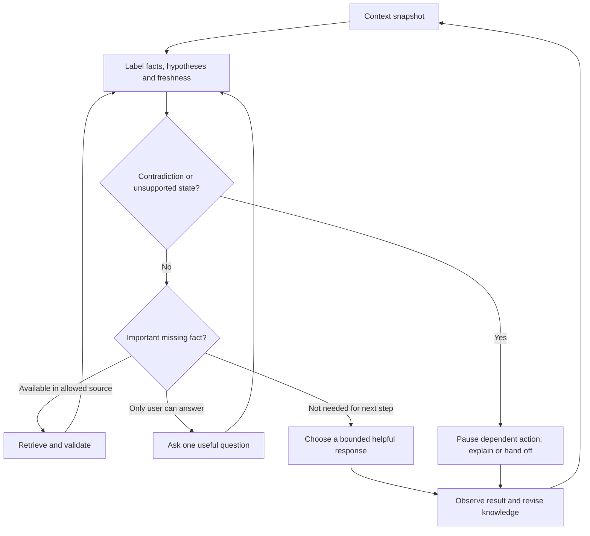
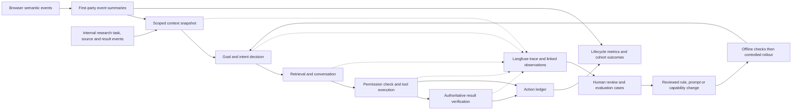
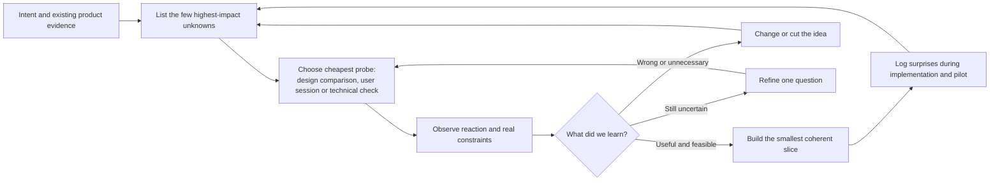

# SBL AI Customer Experience Agent
## Product direction and next-release plan

**Date:** 29 September 2026 · **Revision:** Lifecycle context, journey diagrams and tracing · **Status:** Proposed product scope; no implementation or deployment performed

**Product promise:** Wherever you are in SBL—from your first landing-page visit to your next renewal—get relevant help that understands your journey and helps you take the right next step.

**Recommendation:** Launch one branded, text-and-voice concierge across **sbl.so, its pricing and landing pages, and the authenticated dashboard**, through small owner-installed scripts. It should understand the journey and serve the appropriate objective: discovery, conversion, activation, support, retention or expansion. Give it broad platform knowledge and a narrow set of reliable actions at each stage. Spawn bounded internal research agents when competitor or market evidence would help the current customer goal. Evaluate Jev for fast intent decisions without making launch depend on it.

**Latest discovery-backed plan:** Read the [plain-language summary and Genesis-ready implementation plan](03-cx-discovery-and-implementation-plan.md) first. It incorporates actual public-site and signed-in app discovery, reuse of SBL’s existing MCP/API tools, and the founder’s confirmed action/pricing decisions. Its confirmed decisions take precedence where earlier proposals differ.

**30 September sequencing decision:** Build the advanced concierge on both `sbl.so` landing/pricing pages and the actual SBL dashboard through the existing Chrome extension across M1–M6. WordPress placement and a native dashboard frontend mount are M7 integration work. The first released pilot covers both surfaces without a visitor extension. See the updated milestone table in the implementation plan and the approval candidate in `SPEC.md`.

**Pilot simplification:** Section 20 defines the simplified pilot and takes precedence over earlier candidate P0 lists. It applies the founder-supplied Thariq field guide through an unknowns ledger, design comparisons and a small learning loop.

**Journey maps:** Sections 15–20 contain seven Mermaid diagrams, the behavioral signal contract, 22 lifecycle cases, tracing requirements and the product-learning loop.

**Scope rule:** The website and dashboard are equal product surfaces in the first release. Campaign creation is one activation use case. It must not dictate every conversation, invitation or success metric. Scope for speed by limiting actions within each lifecycle stage, not by removing the website or postponing retention altogether.

The first release is an SBL pilot, not a self-serve platform for every SaaS company. The reusable service comes after we prove that users complete valuable work and that a second deployment can reuse the product.

### Decisions established for this plan

- “SPL” is interpreted as SBL, consistent with this repository and the meeting.
- The founder confirmed that a small website script is acceptable. End users must install nothing.
- “Java” means **Jev, TypeSafe AI’s System One model**. A Java rewrite is not proposed.
- The center-positioned brand/avatar experience in the transcript is the design direction. “RV2” is treated as the transcript’s RB2B reference, not a specification of that website’s current interface.
- This document proposes a new SBL-first direction. Earlier v2.3 documents describe Shopify agent readiness and repair; they are historical context for this decision, not the release contract for the concierge. Those documents remain unchanged.

## 1. What we are selling

**Category:** AI Customer Experience Agent.

**Customer-facing identity:** “Hey SBL” or “SBL Concierge,” with SBL’s animated brand mark. Final naming can follow the pilot; it must not delay delivery.

**Service description:** A concierge for a SaaS website and product that understands the current journey, answers grounded questions, and helps users complete supported tasks through chat or voice.

| Person | Job to be done | Product outcome |
|---|---|---|
| Prospective customer | Understand whether SBL fits my business | A relevant explanation and a clear signup/demo path |
| New user | Turn my sales objective into something usable | A saved campaign draft with clear remaining prerequisites |
| Existing user | Get unstuck or understand the product | A resolved issue, relevant navigation, or a useful human handoff |
| Returning user | Continue without explaining everything again | Resume a verified task in the correct workspace |
| SaaS owner | Improve the complete customer journey | Better discovery, conversion, activation and continued value, with stage-specific evidence |
| Customer seeking a new opportunity | Understand relevant competitor messaging or market changes | A sourced recommendation that can become a reviewed campaign draft |

The differentiator is **context → useful action → verified result**. An attractive avatar introduces that experience; completion gives people a reason to return.

## 2. What already exists, and what we must add

This assessment comes from source inspection, not a live production test. Existing tests were not run for this document. Code presence does not establish deployment readiness, customer adoption, or success rates.

| Area | Evidence in the current implementation | Next product requirement |
|---|---|---|
| Delivery | Chrome manifest injects scripts into SBL marketing and application domains | Website embed, hosted service, versioned rollout and immediate disable control |
| Conversation | Deterministic text flow; text uses the live model when a live session is connected | Useful grounded text conversation independent of microphone/voice connection |
| Voice | WebRTC session setup and local session server | Hosted authenticated/session-limited service, graceful failure and device/browser verification |
| Avatar | Avatar asset, launcher, conversation panel and speaking/listening states | Cohesive animated brand experience with compact center dock and task view |
| Browser actions | Page inspection, named controls, field filling, navigation, overlays and campaign guidance | Explicit action contracts, scope checks, fresh page state, outcome verification and recovery |
| Campaign journey | Brief creation, lead-source selection, ICP description and connection handoff | One end-to-end saved-draft outcome, including existing drafts and validation failures |
| Launch | Separate visible approval; submission asks user to verify SBL confirmation | Approval tied to the exact campaign and verified submission status; no automatic retries after an uncertain result |
| Memory | Conversation, facts and milestones stored through extension storage | Account/workspace-scoped memory, controlled cross-domain handoff, correction and deletion |
| Platform map | Hand-maintained screen/navigation inventory in `core/screens.js` | Reviewed whole-platform coverage register with permission and freshness labels |
| Indexing tools | Recorder captures interactions and API traffic; builder groups endpoints; enrichment can look for source routes | Operator-run indexing process, reviewed capability catalogue, no automatic promotion of observed endpoints into tools |
| Proactive intent | Current page context is collected | Session-level event summary, suppression rules and evaluated intent decisions |
| Internal research delegation | No verified contextual research workflow in the inspected implementation | Bounded research tasks with sources, relevance, progress and traced results |
| Operations | Local health/session endpoints and tests | Pilot analytics, session budgets, tenant boundaries, incident owner and release evidence |

Later live discovery confirmed an MCP setup screen and documented tools; runtime contracts still need validation. Reuse MCP/API as internal execution tools. The founder’s “external agent” means an internally spawned researcher, not an external-agent protocol requirement.

## 3. Aha moments across the customer lifecycle

The common promise is **“SBL understands what I am trying to do here, and helps me make progress.”** Sometimes progress is a clear answer, sometimes a relevant plan recommendation, sometimes a completed action. Forcing every journey into campaign creation would break that promise.

| Surface / moment | Available context | Appropriate experience | Success evidence |
|---|---|---|---|
| Homepage discovery | Entry page, referral/campaign metadata when available, visible section, prior navigation and explicit question | Explain SBL through the visitor’s stated use case; offer relevant feature, example or next page | User confirms fit or reaches the requested information |
| Use-case / campaign landing page | Page promise, audience and CTA, viewed sections, meaningful clicks | Keep the conversation aligned with that landing page; clarify missing requirements | Relevant next step accepted, without contradicting the landing offer |
| Pricing conversion | Current plan content, stated needs, comparison journey and open question | Explain limits, compare eligible plans with sources, offer signup or a human conversation | Question resolved; completed signup/booking measured separately from CTA clicks |
| Signup transition | Agreed goals, open questions and permitted handoff state | Continue into the app without starting the interview again | Context restored to the correct account; no repeat explanation |
| New dashboard user | Role, workspace readiness, actual setup state and chosen objective | Offer the best activation task, which may be a draft, a connection or product orientation | Verified milestone appropriate to that workspace |
| Working dashboard user | Current module, selected object, visible errors and authorized relevant data | Explain, navigate or perform a supported action where the user is working | Issue resolved or result verified |
| Returning / inactive customer | Consented prior goal, last verified task and fresh account state | Resume work or ask what changed; help remove a blocker | Meaningful use resumes; later retention tracked by cohort |
| Trial / renewal / value concern | Authoritative dates, usage and explicit concern where available | Help realize value, explain options or route support; do not fabricate results | Blocker resolution and continued value; eventual renewal is a separate outcome |
| Expansion opportunity | Confirmed new need and actual product/plan eligibility | Explain the relevant capability and tradeoffs; leave purchase decisions to the user | Qualified adoption or user-approved upgrade path, not an unsolicited upsell |

**Website wow:** A visitor arrives on a LinkedIn-focused landing page, explores an agency use case, then asks on pricing, “Which plan fits a five-person agency?” The concierge carries the stated team requirement forward, checks approved plan information, explains the tradeoff and offers a relevant next step. It asks if essential information is missing. It does not introduce an unrelated campaign questionnaire.

**Retention wow:** A returning customer says, “I never finished setting this up.” SBL finds their authorized resumable work, checks what is still missing and offers to fix the next blocker. If the original task is obsolete, the user can replace the goal. Trial timing and campaign performance are used only when available from reliable account data.

### Activation example: “My goal became a real campaign”

1. A visitor explores the website, then opens pricing. The concierge remains quiet until there is meaningful engagement or the visitor opens it.
2. A small, dismissible invitation appears: **“Want to see what your first SBL campaign could look like?”** It does not claim to know the visitor’s motives.
3. The user types or says: **“I sell a CRM to small recruitment agencies. Help me get demos.”**
4. SBL asks only for missing essentials, such as geography and target buyer. It presents an editable audience, campaign brief and suggested next step.
5. The user chooses **“Use this in SBL.”** They complete signup/login themselves. The brief transfers through a short-lived handoff, so they do not repeat it.
6. In the application, the concierge resumes: **“Your agency campaign is ready to prepare. I’ll save a draft; sending is a separate step.”**
7. After the user agrees, it fills the supported workflow, verifies the saved draft, and opens the actual campaign.
8. The result card says **“Draft saved”**, links to the campaign, and lists remaining requirements such as sender connection and leads. It never labels an unsaved form or a proposed brief as a completed campaign.

**Activation aha definition:** The user sees a real saved object that reflects their own goal and can continue working with it. Discovery and retention have their own success criteria above.

**Pilot target:** Within two minutes of a complete brief and an authenticated, eligible workspace. Account creation, external connection time and user decision time are measured separately. This is a target to test, not a current performance claim.

### Two supporting moments

- **“It remembers the work.”** On return: “Continue your recruitment-agency draft?” Check that the campaign still exists and is accessible before offering it.
- **“It helps exactly where I am stuck.”** On a repeated validation error: “This brief needs more detail. Want me to help expand it?” Preserve the user’s existing work.

Avoid theatrical cursor movement that slows completion. Show enough of an action for users to understand it, then show the result.

## 4. The branded experience

The design should feel calm, immediate and deliberate. Use the animated SBL brain/logo first; photorealistic video and custom voice cloning add little to the first outcome.

| State | What the user sees | Behavior |
|---|---|---|
| Resting | Small bottom-center brand dock | Quiet, subtle motion; never covers primary controls |
| Invitation | One short contextual question | Dismissible; no automatic voice playback or microphone request |
| Conversation | Compact centered panel with text entry and optional voice | Short answers; transcript expandable; works fully without audio |
| Listening | Clear microphone state, waveform and live transcript | Visible mute/stop; no inference that silence means consent |
| Thinking | Brief status tied to the task | Show progress if delayed; avoid an indefinite spinner |
| Acting | “Preparing your draft” and the current meaningful step | Relevant control highlighted; pause/cancel available |
| Needs user | Specific missing input or approval | Preserve progress; explain what the user must do |
| Complete | Result, object link and next useful step | Distinguish saved, submitted, blocked and failed |

**Interaction requirements:** Movable dock with reset position; keyboard navigation; readable focus states; reduced-motion mode; accessible status messages; mobile bottom sheet above the keyboard; screen-reader labels; no obstruction of forms or cookie controls. Center placement is a default, not an excuse to cover the product.

**Voice rules:** Ask for microphone access only after “Talk to SBL.” Denial keeps text available. Let users interrupt speech and switch to typing. A stop request prevents new action steps; already committed effects must be explained. Do not promise always-on “Hey SBL” wake-word listening in this release. Microphone permission remains controlled by the browser. [Browser media requirements](https://developer.mozilla.org/en-US/docs/Web/API/MediaDevices/getUserMedia).

**Proposed quality targets:** Visible input acknowledgement within 200 ms; useful text response at p95 within 4 seconds and first voice response at p95 within 2.5 seconds after turn completion on the pilot test network. Measure these before marketing them. Motion should generally settle within 150–250 ms and honor reduced-motion settings.

## 5. Scope: deployable pilot, next release, expansion

### P0 — required for the SBL concierge pilot

| ID | Addition | Why it earns its place | Acceptance |
|---|---|---|---|
| CX-01 | Website script and hosted service | Removes visitor installation and localhost dependency | Works in a fresh browser profile without extension or local server |
| CX-02 | Grounded text and optional voice | Every visitor can use it | Text remains usable without mic permission or voice availability |
| CX-03 | Branded dock and task/result states | Makes the assistant legible and present in the product | Keyboard/mobile/reduced-motion journeys pass; controls stay usable |
| CX-04 | Reviewed SBL knowledge and capability index | Prevents unsupported answers and blind navigation | Every known module has a coverage status; released capabilities have source and owner |
| CX-05 | Reliable campaign draft workflow | Delivers the first meaningful outcome | Real saved draft verified; failure never reported as success |
| CX-06 | Session context and conservative proactive invitations | Makes help timely | Only eligible active sessions qualify; dismissal and suppression work |
| CX-07 | Identity, continuity and scoped memory | Eliminates repeated onboarding | Marketing-to-app brief resumes; account/workspace switch cannot leak context |
| CX-08 | Permissions, action receipt and recovery | Makes action trustworthy | Unsupported or unauthorized mutations denied; uncertain writes reconciled |
| CX-09 | Lightweight operator controls and measurement | Lets the team operate a pilot | Enable/disable, knowledge correction, failure review and cost cap available |
| CX-10 | Human handoff | Recovers when automation cannot help | User can request contact; summary shown before submission; no silent lead creation |
| CX-11 | Website discovery and pricing guidance | Serves visitors before they ever enter the app | Homepage, one representative landing page and pricing each pass contextual Q&A and appropriate CTA tests |
| CX-12 | Lifecycle goal selection | Makes the concierge relevant beyond activation | Explicit request wins; website, new-user, working-user and returning-user scenarios choose appropriate help |
| CX-13 | Basic retention assistance | Helps existing users realize value now | Resumes valid work or resolves a supported blocker; uses verified trial/account facts only when available |

### Research increment — after core context and actions

Start with one focused internal research worker: a relevant competitor question becomes a short sourced brief and an optional campaign recommendation. Validate usefulness with customers before expanding autonomous sourcing. This is milestone M6 in the cumulative launch sequence below; an earlier core preview must state that research is not yet available.

### P1 — after the first outcome is reliable

- Jev-assisted intent decisions promoted from shadow evaluation, if they beat the simpler baseline.
- Context-triggered internal research, followed by a relevant recommendation and an optional draft through the same approved execution layer.
- Returning-user continuity across supported devices after sign-in; a user-visible memory view.
- More assistance for leads, connection recovery, campaign configuration and reports, one verified capability at a time.
- Grounded explanation of actual campaign results when the required data is available.
- Stronger handoff into the chosen support or booking system, based on real pilot demand.

### P2 — service expansion

Onboard a second SaaS design partner; add tenant branding, capability configuration and a repeatable installation process. Deepen the bounded research delivered in M6 with broader source coverage and data-qualified recommendations. Explore predictive retention and revenue optimization after outcome measurement and sufficient data exist. Basic retention help is P0; forecasting churn and autonomous optimization are later capabilities.

**Explicitly defer:** Universal browser control, autonomous spend or outreach, automatic pricing/plan changes, custom human avatars, open-mic wake words, full desktop assistance, cross-customer memory, broad predictive churn, arbitrary website rewriting, and a general-purpose growth-agent swarm.

## 6. Rough SBL indexing first, then broader coverage

“Index the entire platform” should mean **know what exists and what is supported**. It must not mean “automate every endpoint” or “copy every customer’s data.”

Maintain three distinct resources:

| Resource | Contains | Does not contain |
|---|---|---|
| Product knowledge | Approved descriptions, pricing, help, constraints and source dates | Unreviewed commercial promises |
| Capability catalogue | Screens, tasks, inputs, prerequisites, permissions, outcomes and execution support | Automatic permission to invoke every observed API |
| Live workspace context | Current user role, relevant task/object state and allowed account facts | Other customers’ records or a permanent dump of the screen |

### The intentionally manual first pass

1. An SBL operator inventories both surfaces equally: homepage, pricing, all known landing/use-case/feature pages, available help content and signup/demo destinations; then campaigns, workflows, chats, reports, contacts, ICP leads, signals, enrichment, CRM, knowledge base, MCP/API settings and account settings. For landing pages, record the specific promise, target audience, offer and CTA so the concierge preserves page-level context.
2. Walk representative journeys in a designated test workspace with synthetic data. Include empty/populated states, insufficient permissions, missing connections, validation errors and available plan restrictions.
3. Reuse the existing recorder and index builder to associate screens, controls and observed request shapes. Treat time-based request attribution as a candidate association requiring human review.
4. Record screen purpose, available actions, input requirements and success evidence. Use source-route enrichment only when the actual SBL repository/ref is accessible; the existing script’s configured path is not evidence of access on this machine.
5. Review each entry with the product owner. Mark it **known**, **answerable**, **navigable**, **executable** or **blocked**, with separate verification dates. Knowledge coverage and execution coverage are different metrics.
6. Release a versioned, small catalogue. A manually curated file or simple table is enough initially. Add more sophisticated retrieval only when the corpus or measured answer quality requires it.

**Each capability needs:** A stable name, user outcome, relevant screen, authoritative source, account/role requirements, inputs, action side effects, confirmation rule, executor, success check, failure recovery, last validation date and owner.

**Example:** “Prepare campaign draft” requires an authenticated eligible workspace and an agreed brief. It may navigate and fill fields; saving requires permission for the specific action. Success requires a persisted campaign identifier and retrievable draft. It cannot send messages. Missing sender connection is a disclosed next step, not a fabricated success.

**Refresh policy:** Review changed capabilities on each SBL release; immediately disable execution for a capability whose controls or results no longer match. Revalidate pricing before making an offer. Unknown/private routes remain visibly unindexed. The first catalogue should cover every inventoried module, even when the truthful status is “not executable.”

**Data handling:** Existing recorder redaction is a starting point, not a guarantee that screenshots, free text or response bodies are safe. Use synthetic records, restrict captures and review before indexing. Do not index credentials, cookies, message contents or raw customer lead lists into shared product knowledge.

## 7. Browser use: improve the execution contract

**Recommendation:** Keep the supported work in the customer’s current SBL page. Reuse named controls and known workflows. Prefer documented, authorized application actions where available; use constrained DOM interaction for supported gaps. Keep Playwright recording/testing on the operator side.

A small website script can provide page context and operate supported page controls. It does not gain extension privileges or control unrelated tabs. The marketing website and app use different domains, so ordinary browser storage is not a shared memory system. Use a short-lived, single-use server-backed handoff for the brief, then bind it to the authenticated account/workspace. Avoid putting transcripts or personal details in URLs. [Browser origin boundaries](https://developer.mozilla.org/en-US/docs/Web/Security/Same-origin_policy).

For each action, require:

1. **Understand:** Resolve current screen, workspace, role, blocking dialog and requested outcome.
2. **Preview:** Explain meaningful changes and ask only for information/approval the action needs.
3. **Execute:** Choose from reviewed capabilities, respecting existing user edits and app permissions.
4. **Verify:** Confirm the actual saved state or authoritative application result.
5. **Recover:** Reinspect after a mismatch; retry safe reads within a small budget. For uncertain writes, check whether the object already exists before considering another attempt.

Suggested initial retry budget: one reinspection and one safe retry, then offer a precise handoff. A selector failure must not become an unconstrained hunt for a similar button.

The current launch control is a useful foundation, but a browser flag alone is not a production authorization boundary. Any released mutation must still be enforced by the application/service permissions. A launch approval should describe campaign, audience, sender and relevant limits; changed inputs invalidate approval. Pilot success should end at a draft, so launch does not become the critical-path dependency.

Remote browser automation is a later option for explicitly supported background work. It creates a separate session and account-linking problem; it does not automatically inherit the visitor’s logged-in browser. Do not add it solely to make the demo look more autonomous.

## 8. Jev: fast decisions around the conversation

TypeSafe describes Jev as a model that evaluates state and returns typed probabilistic decisions, rather than generating conversational text. This makes it a candidate for classification and routing. Its published latency, cost and calibration claims are vendor evidence, not measured SBL results. Schema-valid output can still be the wrong decision. [TypeSafe introduction](https://typesafe.ai/blog/introducing-system-one-models-and-jev); [LangChain’s integration explanation](https://www.langchain.com/blog/building-a-harness-with-jev).

**Proposed division of work:** Simple rules handle obvious eligibility and permissions; Jev scores ambiguous intent or support needs; the conversational model produces grounded language and plans; the executor performs authorized actions and verifies results.

| Decision candidate | Example input | Possible use |
|---|---|---|
| Intent | Current page, meaningful navigation, explicit question | Exploring, comparing, starting, blocked, returning, unknown |
| Help timing | Active engagement, repeated error, previous dismissal | Wait, offer assistance, remain silent |
| Conversation routing | Question and supported capability list | Answer, clarify, navigate, propose action, hand off |
| Outcome assessment | Structured executor result and visible error | Support a recovery decision; never replace authoritative save verification |

Send compact event summaries after meaningful changes. Do not send raw mouse movement, screenshots or an LLM query every second. Cache equivalent state and stop background processing when the page is hidden or inactive.

**Evaluation proposal:** Start with at least 100 human-reviewed, de-identified or synthetic session traces spanning pricing, exploration, errors, returning users and explicit dismissal. Compare deterministic rules, Jev and the existing model on a held-out portion. Measure useful-invitation precision, missed opportunities, calibration, p95 latency and cost per eligible session. Have product/support reviewers resolve disagreements.

Run Jev in shadow mode first. Proposed promotion gate: at least 90% precision on prompts reviewers judge useful, no suppression-rule violations, and improved coverage or operating cost versus rules without worse task completion. Report sample size and uncertainty. If access, latency or quality is unsuitable, keep the rules baseline. No launch dependency, pricing commitment or model pin is assumed before validation.

Do not treat Jev as memory storage, a browser controller or an authorization service. Zep was mentioned in the meeting, but no additional memory vendor is necessary to define this product.

## 9. Intent and goals without intrusive personalization

### Shared context across the website and dashboard

“All the context” means all relevant, available, permitted context needed for the current decision. It does not mean uploading the entire screen or storing everything indefinitely. The experience must work with unknown fields and say when it lacks information.

| Context layer | Website contribution | Dashboard contribution |
|---|---|---|
| Page | URL, page purpose, content version, visible section, offer and CTA | Module, selected object, open dialog, controls and visible errors |
| Journey | Landing source when available, meaningful page sequence, active engagement, questions and dismissals | Completed milestones, current task and navigation since entry |
| Stated intent | Desired outcome, audience, constraints and buying questions | Current objective, corrections and help requested |
| Account | Anonymous unless reliably identified | Authenticated user, role, workspace, plan and available usage/setup facts |
| Memory | Consented session continuity and agreed facts | Account/workspace-scoped history and resumable tasks |
| Business objective | Discovery, fit, signup or requested demo | Activation, support, continued value, retention or suitable expansion |

On every meaningful page or task transition, refresh page state and reconsider the objective. A user can go from pricing to support, from campaign creation to reports, or from cancellation concerns to a new goal without restarting the conversation. Keep the shared brief and confirmed facts; discard stale page assumptions. Account truth requires a trusted host/backend identity bridge; reading page text alone cannot reliably establish role, plan or renewal status.

Use explicit user requests first, observable product state second, behavior-based hypotheses third. A cursor pause does not prove reading; a pricing visit does not prove budget anxiety; an agency-page click does not prove the visitor runs an agency. Referrer data may be absent and must not be invented.

| Observed stage | Default objective | Useful offer |
|---|---|---|
| Anonymous exploration | Clarify fit | “Want a quick example for your business?” |
| Pricing evaluation | Answer the actual commercial question | “I can explain the plans or help check fit.” |
| Signed in, no campaign | Reach first draft | “Tell me your audience and I’ll help prepare a draft.” |
| Draft with blocker | Remove the next blocker | “Your draft is saved. Next you need a sender connection.” |
| Active campaign | Explain status or diagnose a specific issue | “Want help understanding these results?” |
| Trial ending, supported by account data | Help realize value | “We can finish the remaining setup.” Avoid manufactured urgency. |
| Returning user | Resume verified work | “Continue this draft?” |

The business may configure a default objective by lifecycle stage. The user’s stated objective overrides it: a paid user seeking support must not be pushed toward an upgrade instead.

**Initial invitation policy, to test:** Never open a full conversation automatically. Consider one soft invitation after 20–30 seconds of active engagement plus a relevant signal; repeated errors may justify earlier help. Suppress during typing, sensitive forms, active conversations, hidden tabs and after dismissal. Start with no more than one invitation per session. Measure dismissals and complaints, not just clicks.

Remember confirmed goals and resumable work with provenance. Let users correct or forget them. Do not merge anonymous sessions across devices by guesswork. Suggested pilot retention is 30 days for conversation context, configurable and deletable; enduring campaign data follows the host product’s own policy. Review this with the operating team before rollout.

## 10. Internal research agents: context becomes useful recommendations

The concierge can spawn a separate internal research agent when a customer asks a research question or when a clear, relevant opportunity warrants investigation. This replaces the earlier external-agent/A2A interpretation. Existing MCP/API tools remain useful for execution; no external-agent discovery endpoint is required.

1. **Trigger:** The current goal needs fresh evidence, such as competitor positioning, public offers or a relevant market event. Do not spawn a worker for every visit or mouse movement.
2. **Brief:** Supply the question, relevant business goal, approved public source scope, time/cost limit and expected output. Keep private customer records and credentials out of public search requests.
3. **Research:** Start with one worker, cache reusable findings, deduplicate requests and support cancellation. Show useful progress in the same conversation.
4. **Return:** Findings include source URLs, retrieval dates, uncertainty, conflicting evidence and why the result matters to the current customer. Public messaging is not proof of a competitor’s private results or customer demand.
5. **Recommend:** The concierge synthesizes the evidence into a useful option: “These competitors emphasize speed; your stated advantage is qualification. Want me to draft a campaign around that?”
6. **Act:** Create the requested supported draft, verify it and offer the next step. Obtain specific confirmation before sending, launching, spending or deleting, then execute and verify.
7. **Learn:** Record the parent conversation, child research spans, source references, budget, recommendation, customer response and verified outcome. Inconclusive research should say so rather than invent a strategy.

**Acceptance:** Test a relevant sourced brief, stale/conflicting sources, no useful evidence, privacy boundaries, duplicate requests, cancellation and budget exhaustion. A human reviewer assesses relevance and source support; the application verifies any resulting draft or action. Research output cannot grant additional authority.

The first research increment covers a bounded competitor question and a relevant event question. Continuous market monitoring, a swarm of specialist agents and autonomous campaign optimization remain later experiments.

## 11. Operating the pilot

The operator needs a small control surface, not a large new analytics suite. A protected internal view or configuration workflow is sufficient if it provides:

- Domain and workspace allowlist; feature flags by cohort; kill switch for all actions or one broken capability.
- Brand mark, tone, default stage objectives and invitation frequency.
- Knowledge/capability coverage, stale entries and an owner for corrections.
- Session/task trace: source used, observable trigger, chosen capability, approval, result and timing. Record concise decision reasons, not hidden model reasoning.
- Failure queue and user-approved handoff summary: goal, relevant page, actions attempted and current blocker.
- Daily model/voice budget, per-session limits and graceful degradation to text/help when unavailable.

Host credentials server-side. Authenticate workspace operations, enforce tenant boundaries, and rate-limit public sessions. CORS/origin filtering alone is not session authentication. Let the host application remain usable if the concierge fails to load.

## 12. Measures that tell us whether it works

**Primary product measure:** Eligible journeys that reach their defined useful outcome with concierge assistance. Report this by lifecycle stage; do not hide weak retention or discovery behind strong campaign-draft numbers, or combine unlike outcomes into a misleading conversion rate.

| Lifecycle | Primary outcome | Measurement boundary |
|---|---|---|
| Discovery | Relevant question resolved or requested information reached | Confirm resolution where possible; clicks alone are a proxy |
| Conversion | Completed signup or completed requested booking | Attribute through supported handoff; report missing tracking separately |
| Activation | First verified meaningful product milestone within a day | Campaign draft is the initial action proof, not the only future milestone |
| Support | Issue resolved or accepted human handoff | A closed widget is not a resolved issue |
| Retention | Meaningful return usage at day 7/day 30; later renewal | Needs time and stable cohorts; resumed tasks are early indicators |
| Expansion | Adoption of a relevant additional capability; approved commercial conversion where observable | Separate recommendation clicks, feature usage and paid conversion |

For each stage compare offered-concierge and control cohorts where traffic permits. Keep website visitors and authenticated workspaces as distinct measurement units until a legitimate identity handoff connects them.

| Measure | Definition |
|---|---|
| Supported task completion | Verified successes / supported task attempts; exclude unsupported requests from this denominator but report them separately |
| Time to first draft | Elapsed time from complete brief and eligible signed-in state to verified persisted draft |
| Repeat explanation rate | Resumed sessions in which the user must repeat previously confirmed essentials / resumed sessions |
| Invitation usefulness | Helpful accepted invitations plus reviewer assessment; report dismissal and interruption complaints separately |
| Action reliability | Verified success, recoverable failure, uncertain result and false-success counts |
| Cost per completed outcome | Allocated model, voice, hosting and operator costs / verified completed outcomes |
| Support relief | Observed resolved requests and actual human handling time; no assumed “ticket deflection” from a closed chat |

Track invitation shown/accepted/dismissed, conversation started, brief agreed, action requested, approval recorded, draft verified, handoff, failure and return/resume. Distinguish the user’s actions from the agent’s actions so the agent does not interpret its own clicks as visitor intent.

Start with a small internal cohort, then 5–10 consenting pilot workspaces. These reveal usability and reliability issues, not statistically proven conversion lift. Use a stable workspace-level holdout when volume permits; retain assignment across visits and report exposure failures. A before/after rise is directional evidence only.

## 13. Release gates and implementation order

**“Deploy right away” means the next narrow pilot after its gates pass. The extension cannot be called production-ready by hosting the current server alone.**

These milestones are cumulative planned capabilities, not implemented features. An earlier internal preview may ship behind flags; the complete planned pilot includes M1–M7. Re-estimate dates after M1 verifies the real repositories and contracts. This sequence supersedes earlier provisional calendars and external-agent scope.

| Milestone | Capability available at completion | Completion evidence | Work packages |
|---|---|---|---|
| M1 — Advanced core on both surfaces | In the existing extension, answer a grounded landing/pricing question, carry context into the dashboard, choose the goal, read a scoped campaign, create a safe draft and verify it; trace the journey. | Website-to-dashboard extension journey, persisted draft proof in an approved safe workspace and supported/unverified/unsupported tool map | T01; T02 foundation; T04/T05/T09 first slice; T06 first draft slice |
| M2 — Branded interaction and product knowledge | Improve the brain/avatar, text, optional voice, progress/results and reviewed SBL knowledge on website and dashboard through the extension. | Grounded journeys on both surfaces, keyboard/mic-denial proof and no invented pricing or availability | T02–T03; T09 |
| M3 — Context and changing goals | Across both extension surfaces, understand page/section, meaningful clicks, exposure, active time, explicit intent and verified workspace state; adapt lifecycle goals and resume permitted context. | Lifecycle fixtures, suppression, website-to-dashboard continuity, workspace isolation and inspectable decision traces | T04–T05; T09 |
| M4 — Conversion and first useful work | Guide plan/demo/signup decisions using authoritative offers; carry the brief through the extension's website-to-dashboard journey, reuse or complete a saved draft and complete selected validated lead workflows. | Extension continuity, persisted draft proof and approved import/job outcome verification with no false-success claims | T06–T07; T02/T05 integration |
| M5 — Support, retention and confirmed execution | Diagnose supported campaign/sender issues, explain results, resume unfinished work and handle reviewed run/end/message actions. Ask for exact confirmation, then execute and verify; deletion joins only once its contract passes. | Confirmation/recheck/execute/verify cases, no duplicate effects, returning/inactive/support journeys and useful human handoff | T08; selected T11; T09 |
| M6 — Internal research and useful recommendations | Spawn a bounded researcher for relevant competitor/market questions; return sourced findings, explain their relevance and turn an accepted suggestion into a verified draft. Consequential follow-through uses M5 approval. | Useful and inconclusive research, freshness/conflict review, cancellation/budget limits, parent/child traces and research-to-draft proof | T10; depends on T02/T04–T06/T09 |
| M7 — Native embed and measured pilot | Move the proven concierge into a small WordPress script/iframe and minimal dashboard frontend mount; verify extension-free continuity, feedback, cost/latency monitoring, flags and rollback. Measure useful work/continued use, signup/demo conversion and support resolution. | Clean-browser website/dashboard journeys, end-to-end gates, independent review, no critical defects, monitored cohort and rollback rehearsal | T03 deployment; T04/T06 handoff; T12; T09 completion |

Tracing starts with the first working slice, not M7. Basic lifecycle awareness and support answers arrive before deeper execution. Jev remains an evaluated option; broad research monitoring and unverified product mutations are not launch dependencies. Each milestone ends in a demonstrable user journey plus evidence, not merely infrastructure completion.

### Required human-pilot evidence

- All approved supported journeys run in a fresh browser without an extension. Publish the actual supported browser/device list; target Chrome desktop and Safari desktop/mobile for pilot verification.
- At least 20 reviewed website scenarios spanning homepage, landing pages, pricing, missing referral data and unknown pricing details: at least 90% useful grounded responses, zero invented plan/price promises, and appropriate next steps.
- At least 20 reviewed lifecycle transitions spanning new, working and returning users, support requests and value concerns: at least 90% appropriate objective selection, zero cross-account context exposure and no forced sales prompt during an explicit support request. All suppression cases must pass.
- At least 20 varied eligible draft attempts, with at least 90% verified completion and zero false-success reports. This is a pilot gate, not a reliability guarantee.
- Logout, account switch, workspace switch and cross-domain resume tests show no inappropriate context sharing.
- Mic denial, voice disconnect, model outage and script-loading failure preserve usable text or the host product.
- Duplicate action request, stale page, existing draft, expired login, permission denial and changed form labels produce safe, understandable results.
- No sending, paid action or sensitive account operation occurs through a generic unapproved action path.
- Every P0 feature has an owner and evidence. No critical unresolved defect; operator can disable the concierge without redeploying SBL.
- Latency and cost measured against an agreed pilot budget. If targets are missed, narrow scope or fix the issue before expanding traffic.

Roll out by allowlist, then a small percentage of eligible traffic. Expand only after failure review. Name a human incident owner for the pilot and keep a last-known-good widget version ready.

## 14. Commercial sequence and what to learn next

Prove SBL first, then sell one design-partner service: **install the concierge across the website and product, index both, configure lifecycle goals, enable supported actions, and report outcomes at each stage.** Start with founder-led onboarding and an agreed workflow boundary. Measure the manual indexing and support effort so it does not become invisible delivery cost.

The longer-term packaging can follow Website Concierge, Product Concierge and Growth Agent modules. Those are commercial choices, not a reason to separate the SBL pilot into disconnected assistants or postpone the website. Do not present all three as available products now. Set pricing after observing setup effort, usage costs and customer value; avoid outcome pricing until attribution and billing definitions are trustworthy.

The next decisions are operational, not architectural reinvention: who can deploy the script to both SBL domains, which campaign draft path can be reliably verified, which pilot users have the necessary permissions, and who owns knowledge changes and incidents. Jev access and research sources, budget and freshness rules can be resolved during their bounded evaluations.

## 15. Journey diagrams: a continuous context and goal loop

**Scope note:** These diagrams map the full experience, not separate agents or mandatory services. Section 20 defines the smallest pilot.

**Added from the founder’s lifecycle clarification:** The concierge observes both what happens and what does not happen, maintains uncertainty, and changes its objective as the journey changes. The diagrams describe proposed product behavior, not implemented software. Solid arrows show operational flow; dotted arrows in the tracing diagram show telemetry.

### A. The complete journey: customers and internal research

A research worker receives a bounded question and minimum necessary context from the concierge. Its output is evidence for a recommendation, not permission to launch or send. Deduplicate research by goal and source freshness. A returning person may still be anonymous; returning-session evidence does not establish account identity.

### B. Dynamic goals across the lifecycle

These states are not a mandatory funnel. A visitor on pricing may be an existing customer looking for an invoice explanation. An active customer may need basic orientation. Support requests override conversion goals. Persist a goal while it remains useful; weak cursor changes must not cause constant goal switching.

### C. Website discovery becomes a contextual conversation

The resting greeting can be visible immediately; the proactive question follows eligibility and timing rules. No automatic microphone activation or repeated greeting. Arrival alone does not justify opening a full panel.

### D. Dashboard activation and returning-customer value

Inactivity is a signal, not a churn diagnosis. If an inactive customer is absent, an on-page script cannot talk to them. Background lifecycle suggestions require authorized account events; outbound reactivation needs a separately configured channel and messaging permission. The pilot offers help when they return and does not silently send outreach.

## 16. Behavioral context: what we collect and what it means

The requirement is broad coverage of relevant signals, with an explicit distinction between **observed**, **inferred**, **unavailable** and **stale**. Missing tracking is not equivalent to no activity.

| Founder’s question | Proposed observation | Interpretation boundary |
|---|---|---|
| What are they clicking? | Semantic element ID/name, page/section, timestamp, input method and actor | A click indicates interaction, not necessarily preference or purchase intent |
| What are they not clicking? | Eligible visible CTA exposure, enabled state, observation duration and whether an interaction followed | Only record an exposed-but-not-clicked opportunity; unseen, disabled, obscured or untracked controls are unknown |
| What page are they on? | Route, page purpose, content/offer version and current application module | Refresh on client-side navigation, not only full page loads |
| How many seconds? | Wall time, foreground-visible time and estimated active time as separate fields | A hidden tab is not reading; passive reading can occur without input, so idle cutoffs remain heuristics |
| Where are they looking? | Visible section, scroll pauses, focus and interaction proximity | These are attention proxies. Ordinary site telemetry does not measure actual eye gaze; no gaze claim or camera tracking in this scope |
| Where is the cursor? | Locally sampled pointer position mapped to semantic region; hover duration and movement summaries | Pointer location is not eye position. Touch and keyboard users may have no useful cursor data |
| Are they stuck? | Repeated validation failures, repeated clicks, navigation loops or explicit frustration | Confirm likely blockers; repeated interaction can also be normal exploration |
| What do they already know? | Confirmed statements, prior answers and relevant completed tasks | Page exposure does not prove comprehension |
| What should happen next? | Stated objective, verified state, supported capabilities and unresolved questions | This is a decision informed by evidence, not a directly observed fact |

The browser can observe element intersection with the viewport and document visibility. Neither establishes that a person read a section. [Intersection Observer](https://developer.mozilla.org/en-US/docs/Web/API/Intersection_Observer_API), [Page Visibility](https://developer.mozilla.org/en-US/docs/Web/API/Page_Visibility_API).

**Initial collection proposal:** Capture semantic clicks, navigation, errors and explicit messages as events. Summarize pointer/scroll behavior locally; send changed summaries at most every five seconds while the page is active, with immediate updates for explicit requests and material task changes. Reconsider decisions on meaningful changes or relevant dwell thresholds, not every mouse sample. Start with a maximum of one background intent-model call per ten seconds and tune using measured usefulness and cost. Explicit chat turns are a separate path. These are proposed limits, not a requirement to call a model on every interval.

Use monotonic local durations, event IDs, event time and receive time; deduplicate retries and identify agent-generated actions. Record capture health and missing signals. Mask sensitive fields before collection; do not collect passwords, raw keystrokes, arbitrary page text or unrelated personal data to make the context seem complete. Detailed pointer replay is optional diagnostic work, not required for the pilot.

## 17. Knowns and unknowns: decision framework and cases

This framework now follows the founder-supplied Thariq field guide. Use it both to improve product decisions and to make the concierge honest about uncertainty. Retrieval gaps are tracked separately from tacit user expectations.

| State | Meaning | Required response |
|---|---|---|
| Known known | Fresh verified fact or explicit user statement | Use it with source, timestamp and scope |
| Known unknown | A missing fact that may change the next step | Ask one relevant question or fetch authorized data |
| Unknown known | Tacit expectation or preference that the person recognizes when shown, but has not stated | Offer a concrete example or choice; learn from correction without inventing the preference |
| Unknown unknown | Unexpected route, state, contradiction or failure outside the current catalogue | Detect the mismatch, stop unsupported action, explain and create a coverage issue |

Behavior-derived intent is always a hypothesis alongside these states. Each decision snapshot records observed facts, hypotheses with confidence, important missing facts, current goal, selected response and a short evidence-based reason. Model confidence cannot override missing authority or deterministic suppression rules.

### Case library: different people, goals and wow moments

| Case | Known facts / signals | Unknown or alternative explanation | Goal and response | Wow / success evidence |
|---|---|---|---|---|
| J01 New anonymous landing visitor | Landing-page topic; no stated objective | Role, company and intent | Discovery: light “Hey”; invite a goal when eligible | Relevant explanation without an interrogation |
| J02 Interested visitor, no CTA click | Enabled CTA exposed during active visible time; no click recorded | Comparison, distraction or uncertainty | Offer neutral clarification; never assert price anxiety | Visitor gets the specific answer they needed |
| J03 Long page time, hidden tab | Long wall time; short visible time | Whether visitor is present | Wait; do not launch a sales conversation | No interruption when they return |
| J04 Pricing after use-case exploration | Page sequence and stated team needs | Budget, plan constraints or buying timeline | Explain sourced fit; ask only a decisive missing question | Clear plan tradeoff, no repeated context |
| J05 New signup reaches empty dashboard | Authenticated role; zero campaigns from trusted state | Desired outcome and readiness | Consult first; recommend campaign setup only if appropriate | A relevant first milestone instead of a generic tour |
| J06 Returning customer with draft | Authorized prior goal; draft still exists | Whether objective changed | Offer to resume or revise | Picks up precisely where useful |
| J07 Returning browser, unknown identity | Permitted session history only | Whether same person/account | Neutral continuity; require identity before private context | Helpful without exposing another person’s work |
| J08 Inactive customer returns | Reliable last-activity date and unfinished task | Why they left; whether old goal matters | Ask if they want to resume or start differently | Removes a real blocker without a churn label |
| J09 Active customer in reports | Current report, permitted metrics and explicit question | Cause of performance change | Explain observed results; distinguish hypotheses | Understands results and chooses a grounded next step |
| J10 Paid customer on pricing asks support | Explicit support question; page is pricing | Commercial intent is irrelevant | Resolve support; suppress upgrade pitch | Same agent understands the person beyond the page |
| J11 Trial nearing end | Verified trial date and setup state | Satisfaction or buying decision | Offer value-focused help; explain options honestly | Finishes useful work before deciding |
| J12 Customer expresses cancellation intent | Explicit intent or concern | Reason, if not provided | Help with requested cancellation or explain path; optional assistance without obstruction | Respect and clear resolution, not forced retention |
| J13 Repeated form error | Same visible error and unsuccessful attempts | Bad input, app bug or missing permission | Offer targeted correction; preserve edits | Recovers without restarting |
| J14 Viewer asked to create a campaign | Verified role lacks write access | Who can authorize the action | Explain permission boundary and offer a useful draft recommendation | No false claim of completion |
| J15 Mobile or keyboard-only visitor | Scroll/tap/focus, no meaningful cursor | Attention location | Use available signals; keep confidence conservative | Equivalent help without mouse assumptions |
| J16 User changes goal mid-action | Explicit correction while task is running | Whether a prior write already committed | Stop future steps, reconcile state, then switch goal | User remains in control; no duplicate work |
| J17 Customer asks about competitor messaging | Stated competitor and campaign objective | Current public positioning and relevance | Spawn focused research; cite dated public evidence and separate interpretation | A useful angle the customer can turn into a draft |
| J18 Context suggests a timely opportunity | Verified goal and relevant market/event signal | Whether the opportunity fits this customer | Research the signal; explain relevance; offer a draft, then confirm consequential execution | Timely help that produces useful work |
| J19 Research is inconclusive or interrupted | Budget, source failures or conflicting evidence | What cannot be established | Stop/cancel, report limitations and ask only if clarification helps | Honest uncertainty without fabricated recommendations |
| J20 Seasonal idea for active customer | Relevant dated source and authorized current objective | Applicability, audience and timing | Research a specific relevant event in M6 and offer an optional experiment; broad scanning remains later | Timely suggestion grounded in the customer’s work |
| J21 New UI or conflicting pricing | Observed screen/source conflicts with catalogue | Which source is current | Withhold dependent claim/action; flag owner to refresh | Trust preserved while product knowledge improves |
| J22 Expansion opportunity | User states additional need; verified plan limits | Whether new feature/plan is worth it | Explain options and tradeoffs; no automatic purchase | Adopts something relevant without an unsolicited pitch |

Known unknowns are not all questions to ask immediately. Ask only when the answer changes the current decision. A session can stay in discovery while its desired end outcome is unknown.

## 18. Agent traces, product events and the improvement loop

**Recommendation:** Use Langfuse for agent traces and evaluation, joined to a small first-party product-event stream and an authoritative action ledger. Do not make Langfuse the customer memory store or the sole record of an irreversible action. No tracing service has been configured in this documentation task.

Langfuse supports nested observations of model, retrieval and tool activity, with timing, usage and evaluation scores. Those capabilities fit the required agent-debugging view. [Langfuse observability documentation](https://langfuse.com/docs/observability/overview).

**Implementation reference, verified for this plan:** npm currently reports `@langfuse/tracing` and `@langfuse/otel` at **5.11.1**. Use these exact versions as the initial JS integration baseline and recheck compatibility when implementation begins; no packages were installed here. This is an SDK version, not a claim about the hosted platform version.

### E. What gets traced and how it improves the product

**Trace boundary:** One trace per meaningful decision/turn/task attempt, linked through journey, session and task identifiers. Do not create one enormous trace covering months of customer history. Cross-domain continuity uses the approved handoff; tenant-scoped identifiers must not become an identity bypass.

| Trace component | Required evidence | Question it answers |
|---|---|---|
| Context snapshot | Surface, page version, lifecycle state, relevant event IDs, masked facts, missing fields and freshness | What did the agent actually know? |
| Intent decision | Rules/model version, Jev result if used, candidate intent, uncertainty and suppression result | Why speak, wait or clarify? |
| Goal transition | Previous goal, new goal, triggering event and concise reason | Why did discovery become conversion, support or activation? |
| Knowledge retrieval | Source IDs, catalogue version, retrieved evidence and unresolved conflicts | Was the answer grounded in current product truth? |
| Conversation/model span | Model/version, prompt version, masked input/output, latency, usage and measured/estimated cost label | What did it say, and what did that cost? |
| Action span | Capability, scoped authority, approval reference, redacted inputs, executor and attempt number | What was permitted and attempted? |
| Verification | Result/object reference, postcondition, failure or uncertain status | Did anything actually get done? |
| Human/agent handoff | Task correlation, missing input, accepted handoff and final status | Where did responsibility move? |
| Feedback | User correction/dismissal, reviewer score and eventual observed outcome | Was this useful, accurate and well timed? |

Record **wait/no-action decisions**, rejected actions and missing-data states as well as successful conversations. If routine wait decisions are sampled at scale, retain sampling rates and denominator events. Pilot goal changes, model/tool calls, failures and consequential action receipts should be fully represented after masking. Do not invent token costs when a provider supplies no usage; use clearly labelled estimates.

**Illustrative trace:** Pricing page → CTA visibly exposed for 18 seconds → no click → intent hypothesis “comparing,” confidence unvalidated → known unknown “team size” → offer “Want help comparing plans?” → user says “I’m already a customer; billing issue” → goal switches to support → pricing pitch suppressed → relevant explanation or accepted human handoff. This is a fictional acceptance example, not recorded customer behavior.

**Evaluation scorecard:** Grounded-answer correctness, appropriate goal, invitation usefulness, unnecessary-question rate, false-success count, permission compliance, action completion, latency and cost. Review a mix of new/returning/inactive customers, no-action decisions and internal research tasks. Automated judges assist triage; authoritative state verifies actions and human reviewers adjudicate intent ambiguity.

**Operational acceptance:** For one scenario from every lifecycle stage plus successful, inconclusive and budget-stopped research tasks, the team can inspect the actual decision context, goal transition, response, tool result and final outcome. Inject a tracing outage: bounded asynchronous export must not freeze the user experience. Preserve the action ledger and alert on missing telemetry. Apply role-limited trace access, pre-export masking and the agreed retention/deletion policy to traces as well as conversation memory. Raw audio and screenshots are off by default.

## 19. Additions to the launch backlog and acceptance suite

| ID | New requirement | Pilot acceptance |
|---|---|---|
| CX-14 | Behavioral context contract | Click, exposure-without-click, visibility time, cursor/scroll summary and missing capture are distinguishable; mobile works without cursor data |
| CX-15 | Knowns/unknowns and changing goals | Cases J01–J19 and J21–J22 choose appropriate goals or truthful unsupported responses; J20 covers bounded event research in M6, with broader scanning deferred |
| CX-16 | Decision and action tracing | Real traces link context, model, goal, tools and outcomes; wait decisions and errors visible; masking verified |
| CX-17 | Context freshness and interruption | Account change clears scoped state; navigation invalidates stale page assumptions; stop/change-goal request prevents further old-plan steps |

Include basic context, goal changes and tracing in pilot planning; section 20 makes high-frequency cursor capture and broad negative-click modelling optional experiments. The earlier calendar is superseded by the M1–M7 sequence; estimate dates after M1 contract discovery; optional pointer replay, actual gaze sensing, absent-user outreach and autonomous seasonal campaigns are outside the pilot. The diagrams and case library become the acceptance checklist for product, design and engineering.

## 20. Product judgment: learn the unknowns without overbuilding

**Decision precedence:** This section refines the earlier release scope. Sections 15–19 remain the journey map and scenario library; they are not a demand to implement every branch in the first pilot. Earlier P0 labels are candidate requirements unless included in the pilot boundary below. Keep website and dashboard coverage; reduce execution breadth and speculative infrastructure.

This revision draws on the founder-supplied *A Field Guide to Fable: Finding Your Unknowns*, attributed in the pasted text to Thariq (@trq212). The useful lesson is that a plan represents the work but cannot replace observation of the real product, actual user behavior and implementation constraints. We apply the method without relying on the article’s model-performance claims.

### The four unknowns, applied correctly

| Category | What it means for this product | How we reduce it |
|---|---|---|
| Known knowns | Website and dashboard; no extension; small script allowed; contextual goals; branded chat/voice; context-triggered internal research | Preserve these as product constraints |
| Known unknowns | Which invitation helps, which context is useful, whether Jev improves decisions, what users want to delegate | Run a small comparison or observe the relevant journey |
| Unknown knowns | The founder’s tacit sense of tasteful motion, helpful timing, natural conversation and an appealing brand presence | Show contrasting designs and concrete conversation examples; record reactions as criteria |
| Unknown unknowns | Unexpected constraints or valuable possibilities revealed by actual use, such as obstructive placement, unsupported account states or a better help opportunity | Do a focused blindspot pass, observe users, and log surprises during implementation |

“Information the system has not retrieved yet” is a context-retrieval gap. It can matter at runtime, but it is not the article’s definition of unknown knowns. The runtime case library and this product-discovery framework serve different purposes.

### The smallest coherent product we should build

**One brand presence. One conversation across supported website-to-app transitions. A few useful responses at each lifecycle stage. One reliable action to start.**

| Keep in the pilot | Minimum useful version | What we are trying to learn |
|---|---|---|
| Website discovery and conversion | Contextual answers on homepage, one representative landing page and pricing; a relevant CTA | Does contextual assistance clarify fit or remove an actual objection? |
| Dashboard activation and support | Understand current screen and account readiness; consult, answer or navigate; verify one campaign-draft action | Do users welcome assistance and reach a meaningful outcome? |
| Returning and inactive users | Offer to resume a valid task or ask whether their objective changed when they return | Is continuity useful, and which blockers prevent continued value? |
| Retention and expansion awareness | Respect value concerns, support and cancellation intent; answer relevant capability questions | Can we help existing customers without turning every interaction into sales? |
| Branded interaction | A polished compact dock, readable text, optional voice and clear acting/result states | Does it feel welcome, understandable and worth using again? |
| Context | Current page/section, explicit request, meaningful clicks, visible-time estimate, task state, permission and relevant memory | Is this enough to make useful decisions? |
| Observability and controls | One trace destination, a few structured product events, application-backed action receipts, budget and kill switch | Can we explain failures and operate the pilot confidently? |
| Index | Manually reviewed page/capability catalogue with coverage labels | Can we keep answers and the first action correct without building a crawling platform? |
| Internal research proof (M6) | One bounded competitor brief with sources and a relevant next action | Does research help the customer make progress? |

The scope covers the lifecycle through context and helpful responses. It does not promise automated remedies for every retention or expansion problem. An inactive customer who has not returned cannot be reached by the website script alone.

**Keep the basic safeguards already specified:** account/workspace separation, grounded pricing, microphone choice, truthful outcome verification and authorization for actions. They are part of a usable product, not experiments to postpone.

### What becomes an experiment rather than a launch dependency

| Earlier ambition | Simpler starting point | Evidence required before adding complexity |
|---|---|---|
| Capture every pointer movement | Semantic clicks, visible sections and time summaries | Labelled sessions show cursor/hover summaries materially improve helpful timing or diagnosis |
| Infer every unclicked control | Exposure tracking for one or two important CTAs | The signal improves a specific invitation; capture is reliable enough to distinguish missing data |
| Jev on a continuous decision loop | Rules for eligibility; Jev offline/shadow on selected ambiguous cases | Better decisions, coverage or cost on held-out examples |
| A separate goal-planning agent | A small goal policy using user request, page and verified state | Real failures cannot be addressed by extending the policy simply |
| Complex long-term memory | Confirmed facts plus a resumable task scoped to account/workspace | Users need more continuity and simple summaries demonstrably lose relevant information |
| Comprehensive automatic indexing | Manual reviewed catalogue; extend on demand | Update workload or coverage gaps justify automation |
| Sophisticated retention predictions | Respond to explicit concerns and verified blockers | Enough historical outcomes exist to validate a useful forecast |
| Always-on research and broad seasonal scanning | Human-curated examples first, then one bounded research worker in M6 | Targeted research is repeatedly useful before expanding sources or frequency |
| Full admin platform | Small protected configuration/review view using existing tools | Operational volume makes manual configuration the bottleneck |
| Separate event platform and custom trace UI | Existing event storage plus Langfuse; stable correlation IDs | Actual scale, analysis needs or tool limitations justify another system |

Do not implement the proposed five-second summary and ten-second model cadence as universal requirements. They were initial bounds, not validated interaction needs. Start event-driven, with timers only for a specific invitation rule. More telemetry is not automatically better understanding.

### Blindspot pass: high-impact assumptions to challenge

| Assumption | What could be different in reality? | Cheapest useful check |
|---|---|---|
| Center placement feels premium | It may cover a CTA, table or mobile keyboard | Review the dock against actual pricing, dashboard and mobile layouts |
| Proactive greeting is helpful | The visitor may want to explore in peace | Compare a quiet dock with one soft invitation in observed sessions |
| Voice makes the experience delightful | Users may prefer typing at work or in public | Offer both; measure voluntary choice and recovery from mic denial |
| Page behavior reveals intent | The same page sequence may represent buying, support or research | Ask users what they were trying to do; compare with inferred intent |
| Whole-platform knowledge is the immediate bottleneck | A few repeated questions or one broken workflow may dominate | Review the first pilot questions and failures before expanding the index |
| Persistent memory creates trust | Incorrect or overly personal recall may feel intrusive | Show editable confirmed facts and a neutral resume prompt |
| Smooth automation creates the wow | Users may care more about understanding the result and retaining control | Show a concise action preview, pause control and verified result |
| Returning means retention risk | The person may be a healthy infrequent user | Use their stated goal and real account context; avoid a churn label |
| Automatically researched suggestions are always useful | Generic or poorly timed advice may distract | Compare sourced recommendations with customer goals and observe accepted next actions |

### Taste discovery: three directions to react to before implementation

These are design briefs, not built prototypes. A future design pass should show the same landing-page, pricing and dashboard scenario in each direction so the comparison is about experience rather than different content.

| Direction | Appearance and behavior | Tradeoff |
|---|---|---|
| **A — Quiet brand dock** (recommended starting point) | Small animated SBL brain at bottom center; one-line invitation; expands on interaction; docks away from active controls | Strong brand presence with restrained interruption |
| **B — Brand companion** | Slightly larger expressive mark; voice waveform and short captions; strong speaking/listening states | Memorable voice presence, but more space and visual attention |
| **C — Contextual guide** | Small brand entry point; help appears near the relevant section/control after engagement | Strong connection to the task, but less consistently centered and harder to position |

The founder’s center-avatar preference is a known constraint for the starting direction. The open question is how prominent, expressive and mobile it should be, and how it moves when it would obstruct work.

**Reaction prompts:** Which feels like SBL? Which would you leave open while working? Which feels intrusive? Can you tell whether it is listening, thinking or acting? Is the result clearer than the animation? Capture concrete reactions such as “this covers the pricing comparison” rather than broad labels like “make it more premium.”

**Product quality bar:** Useful before impressive; polished without waiting on animation; brief without losing context; proactive without pressure; remembers confirmed facts without pretending to know the person. When uncertain, one natural question should feel better than a confident wrong recommendation.

### A small learning loop, before and during the build

Start with five observed sessions across a new visitor, a pricing evaluator, a new dashboard user, a returning/inactive user and an active customer with a support need. This is qualitative discovery, not a conversion experiment. Watch whether each person understands the invitation, gets relevant help, sees a useful result and chooses to continue. Include keyboard/mobile review and a separate bounded research evaluation with source and relevance review.

Maintain one short **unknowns ledger in this document**: assumption, cheapest check, owner, evidence, decision and revisit trigger. No separate research management platform. During future implementation, keep temporary notes for deviations and surprises; promote only lasting decisions back into this document.

| Priority unknown | Owner | Probe | Current state / revisit trigger |
|---|---|---|---|
| Will the dock feel welcome across both surfaces? | Product/design + founder | Compare the three directions in the same screens | Unvalidated; choose based on concrete reactions |
| Does the first invitation improve understanding? | PM | Observe quiet versus soft-invitation sessions | Unvalidated; change if repeatedly ignored or disruptive |
| Which signals change the right next response? | PM + engineer | Review intent decisions with and without extra signals | Unvalidated; add cursor data only for demonstrated benefit |
| Can the agreed goal survive website-to-app transition? | Engineer | Test real signup/login and workspace switches | Design specified; runtime unverified |
| Is the first action reliably useful? | SBL owner + engineer | Observe a real draft journey and recoverable failures | Existing source foundation; release evidence required |
| Do users want voice enough to justify its complexity? | PM/design | Observe voluntary voice use and text fallback | Unvalidated; retain text as a complete experience |
| Does internal research create useful next steps? | Backend + PM | Sourced brief, relevance review and observed draft acceptance | Planned; one bounded worker before broader scanning |

### Revised shipping decision

Ship the pilot when the small coherent experience above works and the applicable safety/correctness gates pass. Treat the 22 cases as review coverage: a valid answer can be “I need one more detail,” a grounded explanation or a clear unsupported boundary. Do not turn every case into a separate feature or agent.

Review stage-specific metrics and real reactions before adding capabilities. Keep an addition only if it improves a user outcome, answers a consequential unknown, or makes operation materially more reliable. Remove features that create no demonstrated value. The desired wow is **“it understood me and helped”**—with a brand experience people enjoy seeing.

## 21. Discovery update and confirmed founder decisions

The [implementation plan](03-cx-discovery-and-implementation-plan.md) now supplies the short capability summary, screen-specific interventions, proposed storage, requirement IDs and Genesis work packages. Evidence: [public website](07-sbl-public-site-discovery-2026-09-29.md) and [authenticated app](08-sbl-app-discovery-2026-09-29.md).

- **Act after confirmation:** Consequential actions, including supported deletion, belong in the product. Ask about the exact action and target, accept the user’s specific yes, recheck authority, execute and verify. Do not stop at instructions merely because an action is consequential. Actual authentication/payment platform requirements still apply.
- **Reuse what SBL already has:** Public documentation lists 30 MCP tools; the app has MCP management and API documentation. Validate and reuse them before browser automation. Earlier source inspection covered only the extension and understated the broader product surface.
- **Use dashboard pricing truth:** Current dashboard/backend quote and eligibility govern. Public pricing can be explained; a discount/offer must come from an actual authoritative source. Do not invent an offer when pages differ.
- **Measure all three outcomes:** Useful work and continued use; website signup/demo conversion; support resolution.
- **Persist context deliberately:** Use existing first-party event storage where possible, scoped task memory, Langfuse for agent traces and application action receipts. The chosen backend/analytics stack remains to be discovered; no collection has been installed yet.
- **Keep discovery honest:** 213 public URLs mapped and 20 public pages read; major app modules visited and campaigns inspected in two workspaces. This is not an exhaustive test of every page, record or action.

## Evidence and references

**Internal implementation inspected:** The following files establish what is present. Comments and README claims were not treated as live test results.

- [MVP README](/path/to/sbl-concierge/README.md), [extension manifest](/path/to/sbl-concierge/manifest.json), [widget and action implementation](/path/to/sbl-concierge/content.js), [local session server](/path/to/sbl-concierge/server.mjs).
- [Conversation flow](/path/to/sbl-concierge/flow.js), [screen catalogue](/path/to/sbl-concierge/core/screens.js), [memory](/path/to/sbl-concierge/core/memory.js), [tool definitions](/path/to/sbl-concierge/live-config.mjs).
- [Workflow recorder](/path/to/sbl-concierge/tools/capture/record.mjs), [index builder](/path/to/sbl-concierge/tools/capture/build-index.mjs), [source enrichment](/path/to/sbl-concierge/tools/capture/enrich.mjs).
- Founder-supplied [Thariq field guide text](</path/to/developer/.codex/attachments/de44f925-7738-4965-86b6-b1843005c249/Pasted text.txt>), used as a product-discovery reference, not an implementation instruction.
- User’s supplied 29 September meeting transcript and category/packaging notes; confirmed Jev and website-script clarification in this chat.

**External primary sources checked 29 September 2026:** [TypeSafe Jev introduction](https://typesafe.ai/blog/introducing-system-one-models-and-jev), [LangChain Jev integration](https://www.langchain.com/blog/building-a-harness-with-jev), [MDN same-origin policy](https://developer.mozilla.org/en-US/docs/Web/Security/Same-origin_policy), [MDN microphone access](https://developer.mozilla.org/en-US/docs/Web/API/MediaDevices/getUserMedia). Local source snapshots are saved in the repository’s `.firecrawl` directory under `cx-*` names. No vendor performance claim is an SBL benchmark.
